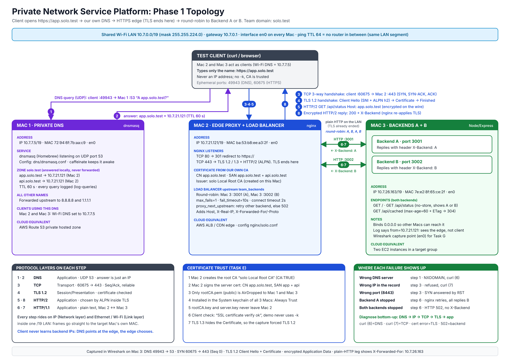

# Architecture Document (Phase 1)

## 1. Network topology

Full annotated diagram: `topology.png` (also `topology.svg`, editable).



Text version:

All three Macs are on one Wi-Fi network, one /19 subnet, behind one gateway.

```
                         Wi-Fi: 10.7.0.0/19   (gateway 10.7.0.1)
   +----------------------+----------------------+----------------------+
   |                      |                      |                      |
 Mac 1                  Mac 2                  Mac 3
 10.7.7.5               10.7.21.121            10.7.26.163
 DNS (dnsmasq :53)      Edge (nginx :80/:443)  Backend A :3001
 + test client          TLS + load balancer    Backend B :3002
                                               + Wireshark client
```

Team of three: Backend B and the capture client share Mac 3 with Backend A. They differ only by port.

## 2. IP and service inventory (Task A)

| Role | Machine | IP | Mask / prefix | Gateway | Interface | MAC |
|---|---|---|---|---|---|---|
| Private DNS + client | Mac 1 | 10.7.7.5 | 255.255.224.0 (/19) | 10.7.0.1 | en0 | 72:94:6f:7b:aa:c9 |
| Edge proxy + LB | Mac 2 | 10.7.21.121 | 255.255.224.0 (/19) | 10.7.0.1 | en0 | ba:53:b8:ee:a3:2f |
| Backends A + B + capture | Mac 3 | 10.7.26.163 | 255.255.224.0 (/19) | 10.7.0.1 | en0 | 7e:e2:8f:65:ce:2f |

The /19 network covers 10.7.0.0 to 10.7.31.255. All three IPs are inside it. Pings show `ttl=64` (macOS default), so no router sits between the Macs: they are on the same LAN segment.

| Service | Machine | Port / protocol | Config |
|---|---|---|---|
| DNS (dnsmasq) | Mac 1 | 53 UDP | `dns/dnsmasq.conf` |
| nginx HTTP redirect | Mac 2 | 80 TCP | `nginx/solo.conf` |
| nginx HTTPS + LB | Mac 2 | 443 TCP | `nginx/solo.conf` |
| Backend A (Express) | Mac 3 | 3001 TCP | `backend/server.js` |
| Backend B (Express) | Mac 3 | 3002 TCP | `backend/server.js` |

DNS records (zone `solo.test`, TTL 60 s): `app.solo.test` and `api.solo.test` both resolve to **10.7.21.121** (Mac 2).

Clients using the private DNS: Mac 2 and Mac 3 (Wi-Fi DNS = 10.7.7.5); Mac 1 also verified.

## 3. Request flow with protocol layers

```
1. Client asks: who is app.solo.test?
   DNS over UDP/53        client:49943 -> Mac 1 :53       answer 10.7.21.121
2. TCP three-way handshake to the edge
   SYN / SYN-ACK / ACK    client:60675 -> Mac 2 :443      Seq 0 (relative)
3. TLS 1.2 handshake (Client Hello with SNI + ALPN)
   Client Hello -> Server Hello, Certificate, Server Key Exchange, Server Hello Done
   -> Client Key Exchange, Change Cipher Spec, Finished (both ways)
4. HTTP/2 request (encrypted): GET /api/status, Host: app.solo.test
5. nginx terminates TLS, picks a backend round-robin, forwards plain HTTP
   Mac 2 -> Mac 3 :3001 (A) or :3002 (B)
6. Backend replies with JSON + X-Backend; nginx re-encrypts to the client
```

TLS ends at nginx. nginx to backend is plain HTTP on the LAN. The backend therefore logs the edge's IP (`from=10.7.21.121`); the real client IP is in `X-Forwarded-For`.

## 4. OSI / TCP-IP mapping

| Item | OSI layer | TCP/IP layer |
|---|---|---|
| DNS, HTTP/1.1, HTTP/2, REST | 7 Application | Application |
| TLS (encryption, certificates) | 5/6 Session/Presentation | Between Application and Transport |
| TCP (ports 443, 3001, 3002), UDP (port 53) | 4 Transport | Transport |
| IP (10.7.x.x addressing) | 3 Network | Internet |
| Ethernet II frames, MAC addresses, Wi-Fi | 2 Data link | Link |

## 5. Cloud equivalents

| Our component | Cloud equivalent |
|---|---|
| Mac 1 dnsmasq | AWS Route 53 private hosted zone |
| Mac 2 nginx edge (TLS + round-robin + health handling) | AWS Application Load Balancer / CDN edge node, GCP Load Balancer |
| `max_fails` / `fail_timeout` | Load balancer health checks (passive) |
| Mac 3 Backend A and B | Two EC2 instances in a target group |
| Local root CA | AWS Certificate Manager / a private CA |
| Cache-Control + ETag | CDN caching (CloudFront) |

## 6. Single points of failure

Mac 1 (DNS) and Mac 2 (edge). Phase 2 adds a backup resolver and a standby edge with a DNS cutover.
